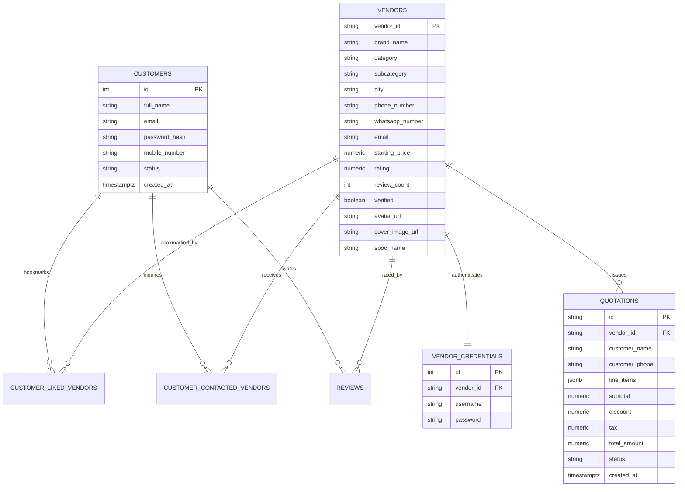

# Happy Moments (HM) — Comprehensive Technical & Product Documentation

> **Platform Overview**: Happy Moments is a full-stack Event Management & Vendor Marketplace platform connecting customers, wedding/event vendors, and platform administrators across India. It features real-time search, vendor portfolios, quotation & invoice generation, customer wishlists, automated leads management, and the interactive **Momo AI** companion mascot.

---

## Table of Contents
1. [System Architecture & Tech Stack](#1-system-architecture--tech-stack)
2. [Repository Structure](#2-repository-structure)
3. [User Portals & Functional Modules](#3-user-portals--functional-modules)
   - [Customer Experience](#31-customer-experience)
   - [Vendor / Business Portal](#32-vendor--business-portal)
   - [Admin Portal](#33-admin-portal)
   - [Momo AI Mascot & Companion](#34-momo-ai-mascot--companion)
4. [Database Architecture & Core Schema](#4-database-architecture--core-schema)
5. [Authentication & Session Flow](#5-authentication--session-flow)
6. [Quotation & PDF Invoice Engine](#6-quotation--pdf-invoice-engine)
7. [Local Development Setup](#7-local-development-setup)
8. [Mobile App Build Guide (Capacitor Android)](#8-mobile-app-build-guide-capacitor-android)
9. [Production Deployment & Environment Variables](#9-production-deployment--environment-variables)
10. [Known Pitfalls & Troubleshooting Guide](#10-known-pitfalls--troubleshooting-guide)

---

## 1. System Architecture & Tech Stack

```mermaid
flowchart TD
    subgraph ClientLayer ["Client Layer (Web & Mobile)"]
        SPA["Vite + React 18 + TS (SPA)"]
        Capacitor["Capacitor Android Native Shell"]
        PWA["Vite PWA Service Worker"]
    end

    subgraph ServiceLayer ["Application Services"]
        SupabaseClient["Supabase JS Client (Direct DB / Auth / Storage)"]
        ExpressAPI["Express Backend (Node.js :3001)"]
        Nodemailer["SMTP / Nodemailer Email Service"]
        Puppeteer["Puppeteer PDF Generation Engine"]
    end

    subgraph DataLayer ["Data & Cloud Infrastructure"]
        Postgres[("Supabase PostgreSQL Database")]
        Storage[("Supabase Storage Buckets (Images & PDFs)")]
        VercelCDN["Vercel Global Edge Network (Frontend Hosting)"]
    end

    SPA -->|Direct Queries / Realtime| SupabaseClient
    SupabaseClient -->|PostgreSQL Wire / RLS| Postgres
    SupabaseClient -->|Media & Document Assets| Storage

    SPA -.->|Proxy /api (Local Dev)| ExpressAPI
    ExpressAPI -->|Transactional Emails| Nodemailer
    ExpressAPI -->|Headless Render| Puppeteer
    ExpressAPI -->|Admin Ops| Postgres

    VercelCDN -->|Serves Static Bundle| SPA
    Capacitor -->|Wraps SPA Build| SPA
```

### Technology Breakdown

| Tier | Technologies / Libraries |
| :--- | :--- |
| **Frontend Framework** | **React 18** (Vite bundler), **TypeScript**, **React Router v6** |
| **Styling & UI Kit** | **Tailwind CSS**, **shadcn/ui** (Radix UI primitives), **PrimeReact**, **Lucide Icons** |
| **State Management** | **React Context API** (`CustomerAuth`, `BusinessAuth`, `Auth`), **TanStack React Query**, **Zustand** (`userStore`) |
| **Animation & Media** | **Framer Motion**, **Lottie-web**, HTML5 Canvas animations |
| **Mobile Runtime** | **Capacitor 8** (`@capacitor/android`, `@capacitor/core`, `@capacitor/keyboard`) |
| **PWA Engine** | **Vite PWA Plugin**, Service Workers, Web App Manifest |
| **Database & Auth** | **Supabase** (PostgreSQL 15+, Row Level Security, Supabase Storage) |
| **Backend & Services** | **Node.js**, **Express 4**, **Nodemailer** (SMTP), **Puppeteer** (Headless Chromium for PDF rendering) |
| **Hosting & CI/CD** | **Vercel** (Production Frontend), GitHub (`SaiSanjit/HappyMoments`, `Bindu7777/Backup_hm`) |

---

## 2. Repository Structure

```text
HM_MAY/
├── frontend/                     # React + Vite + TypeScript application
│   ├── public/                   # Static assets (favicons, PWA icons, fonts, sound effects)
│   ├── src/
│   │   ├── components/           # Reusable UI widgets & domain components
│   │   │   ├── layout/           # Header, Footer, Navigation, Category bars
│   │   │   ├── momo/             # Interactive Momo hamster companion & chat UI
│   │   │   ├── ui/               # shadcn/ui components (Button, Dialog, Sheet, etc.)
│   │   │   ├── AddReviewModal.tsx
│   │   │   ├── InvoiceQuotationPreview.tsx
│   │   │   ├── LikeButton.tsx    # Customer wishlist toggle
│   │   │   └── VendorLogin.tsx   # Modal & inline vendor authentication
│   │   ├── contexts/             # Global authentication and session providers
│   │   │   ├── CustomerAuthContext.tsx  # Customer session, login, signup
│   │   │   ├── BusinessAuthContext.tsx  # Business owners / vendors session
│   │   │   └── AuthContext.tsx          # General Supabase auth
│   │   ├── pages/                # Routed views
│   │   │   ├── Index.tsx                # Homepage (Hero, Categories, Top Vendors)
│   │   │   ├── CategoryVendors.tsx      # Filterable category listing
│   │   │   ├── vendor.tsx               # Public vendor detail & booking profile
│   │   │   ├── CustomerSignup.tsx       # 2-step customer account creation
│   │   │   ├── CustomerLogin.tsx        # Customer login & forgot password
│   │   │   ├── CustomerDashboard.tsx    # Customer profile & bookings
│   │   │   ├── LikedVendors.tsx         # Customer saved/wishlist vendors
│   │   │   ├── VendorDashboard.tsx      # Vendor management & quotation suite
│   │   │   ├── VendorProfileEdit.tsx    # Vendor portfolio, pricing, media edits
│   │   │   ├── VendorTutorial.tsx       # Interactive vendor walkthrough & videos
│   │   │   ├── AdminDashboard.tsx       # Super-admin control panel
│   │   │   └── MomoBotPage.tsx          # Admin control for Momo Bot
│   │   ├── services/             # Supabase & backend API wrappers
│   │   │   ├── supabaseService.ts       # Core database queries (vendors, reviews, leads)
│   │   │   ├── supabaseStorageService.ts# Media upload & retrieval to Supabase buckets
│   │   │   ├── invoiceService.ts        # Quotation/invoice calculation & persistence
│   │   │   ├── pdfService.ts            # Client-side PDF generation (html2canvas & jsPDF)
│   │   │   └── emailVerificationService.ts
│   │   ├── config/api.ts         # Centralized API base URL resolver
│   │   ├── lib/supabase.ts       # Supabase client singleton
│   │   └── App.tsx               # Master route configuration & providers
│   ├── vite.config.ts            # Vite config, dev proxy (:3001), PWA setup
│   └── package.json
├── backend/                      # Optional Node.js Express microservice
│   ├── routes/
│   │   ├── email.js              # Nodemailer verification & notification routes
│   │   ├── likedVendors.js       # Express proxy for customer likes
│   │   └── contactedVendors.js   # Express proxy for vendor inquiries
│   ├── server.js                 # Express listener on port 3001
│   └── package.json
├── android/                      # Native Android project generated by Capacitor
├── migrations/                   # SQL database migration files & RLS policies
│   ├── momo_bot_schema.sql
│   └── ...
└── package.json                  # Root scripts & tooling
```

---

## 3. User Portals & Functional Modules

### 3.1. Customer Experience

| Feature | Description | Key Route | Primary Components |
| :--- | :--- | :--- | :--- |
| **Category Discovery** | Filter vendors by category (Venues, Photographers, Decorators, Catering, Makeup, DJs, Mandapas). | `/category/:category` | `CategoryVendors.tsx`, `VendorShortCard.tsx` |
| **Vendor Profile** | Public page with photo carousel, packages, pricing, SPOC details, address map, reviews, and quick inquiry. | `/vendor/:vendorId` | `pages/vendor.tsx`, `AddReviewModal.tsx` |
| **Account Creation** | Step 1: Basic Info with direct email uniqueness check. Step 2: Mobile number (supports Indian +91 and US +1 formats) & password. | `/customer-signup` | `CustomerSignup.tsx`, `CustomerAuthContext.tsx` |
| **Customer Wishlist** | Instant bookmarking of preferred vendors via heart button; displays in central saved tab. | `/liked-vendors` | `LikedVendors.tsx`, `LikeButton.tsx` |
| **Quick Inquiries** | Direct inquiry submission with event date, guest count, and WhatsApp redirect. | `/vendor/:vendorId` | `customer_contacted_vendors` table |

### 3.2. Vendor / Business Portal

| Feature | Description | Key Route | Primary Components |
| :--- | :--- | :--- | :--- |
| **Vendor Onboarding** | Self-serve business registration for event professionals in Hyderabad and across India. | `/vendor-onboarding` | `VendorOnboarding.tsx`, `BusinessSignup.tsx` |
| **Vendor Dashboard** | Central operational hub: Profile overview, quick stats, inquiries, quotation manager. | `/vendor-dashboard` | `VendorDashboard.tsx`, `BusinessDashboard.tsx` |
| **Profile & Portfolio Studio** | Update brand logo, hero cover banner, gallery photos, starting price, service list, and contact person. | `/vendor-profile-edit` | `VendorProfileEdit.tsx`, `supabaseStorageService.ts` |
| **Quotation & Invoice Generator** | Full-fledged document creator with customer name, line items, taxes, discounts, terms, and PDF export. | `/vendor-dashboard` | `InvoiceQuotationPreview.tsx`, `invoiceService.ts` |
| **Vendor Feature Walkthrough** | Interactive tutorial explaining features with high-definition vertical video guide. | `/vendor-tutorial` | `VendorTutorial.tsx`, `VendorMobileWalkthroughVideo.tsx` |

### 3.3. Admin Portal

* **URL**: `/admin/dashboard` (Auth: `/admin/login`)
* **Capabilities**:
  1. **Vendor Moderation**: Review incoming vendor registrations, edit details, approve verification badges.
  2. **Platform Inquiries**: Audit customer leads dispatched to vendors.
  3. **Momo Bot Management** (`/admin/momo`): Configure AI knowledge base, Instagram/Google Analytics integrations, and bot triggers.

### 3.4. Momo AI Mascot & Companion

* **Mascot Component**: [MomoScreenCompanion.tsx](file:///Users/sivamarella/Desktop/HM_MAY/frontend/src/components/momo/MomoScreenCompanion.tsx)
* **Behaviors**:
  - Floats persistently in the bottom corner of every page without obstructing UI actions.
  - Interactive physics: Ear twitches, natural blinking, nose sniffing whiskers, paw waving, and playful hop when clicked.
  - Context-aware recommendations: Suggests top-rated photographers, venues, and caterers matching the user's active page.

---

## 4. Database Architecture & Core Schema

The application runs on **Supabase (PostgreSQL)**. Key tables and relationships:



### Storage Buckets (Supabase Storage)
1. **`vendor-images`**: Stores vendor portfolio media, gallery photos, and cover images.
2. **`vendor-logos`**: Stores transparent brand icons and profile avatars.
3. **`quotations`**: Stores exported PDF files generated by vendors for easy sharing over WhatsApp.

---

## 5. Authentication & Session Flow

Happy Moments separates authentication into three dedicated contexts:

1. **Customer Auth (`CustomerAuthContext`)**:
   - Stores session token / customer ID in `localStorage` under key `customer_id`.
   - On signup, users are registered with status `'verified'` and authenticated automatically.
   - Login validates email and base64 credentials against the `customers` table.

2. **Vendor / Business Auth (`BusinessAuthContext` & `supabaseService.ts`)**:
   - Vendors log in with username/email and password via `vendorLogin()`.
   - Session stored in `localStorage` as `vendor_session` containing `vendor_id`, `brand_name`, and profile details.
   - Guarded by `<VendorProtectedRoute>` in `App.tsx`.

3. **Admin Auth (`AdminLogin.tsx`)**:
   - Access key authentication guarding `/admin/dashboard` and `/admin/momo`.

---

## 6. Quotation & PDF Invoice Engine

Vendors can generate client-ready estimates and tax invoices from their dashboard.

```
[Vendor Dashboard]
       │
       ▼
 [Invoice Form]  ──► (Customer info, Event Date, Line items, Quantity, Rate, Tax %)
       │
       ▼
[Live Preview]   ──► (Branded template with Vendor Logo, Terms & Bank Details)
       │
       ├──► "Download PDF"  (Rendered via jsPDF + html2canvas on client)
       └──► "Save to Cloud" (Uploaded to Supabase bucket & persisted in 'quotations')
```

Key files:
- [InvoiceQuotationPreview.tsx](file:///Users/sivamarella/Desktop/HM_MAY/frontend/src/components/InvoiceQuotationPreview.tsx): WYSIWYG modal for styling and live calculation.
- [invoiceService.ts](file:///Users/sivamarella/Desktop/HM_MAY/frontend/src/services/invoiceService.ts): CRUD operations against `quotations` table.
- [pdfService.ts](file:///Users/sivamarella/Desktop/HM_MAY/frontend/src/services/pdfService.ts): High-DPI rasterization and pagination into standard A4 PDF.

---

## 7. Local Development Setup

### Prerequisites
- **Node.js**: v18.x or v20.x+
- **npm**: v9+
- **Git**

### Step-by-Step Instructions

1. **Clone the repository**:
   ```bash
   git clone https://github.com/Bindu7777/Backup_hm.git
   cd Backup_hm
   ```

2. **Install Frontend Dependencies**:
   ```bash
   cd frontend
   npm install
   ```

3. **Configure Environment Variables**:
   Create `frontend/.env`:
   ```env
   VITE_SUPABASE_URL=https://hemofpnccbnfcmlibxbr.supabase.co
   VITE_SUPABASE_ANON_KEY=eyJhbGciOiJIUzI1NiIsInR5cCI6IkpXVCJ9...
   VITE_API_BASE_URL=http://localhost:3001
   ```

4. **Start the Frontend Dev Server**:
   ```bash
   npm run dev
   ```
   *Frontend opens at*: `http://localhost:8080` (or `http://localhost:5173`).

5. **(Optional) Run Backend Express API**:
   ```bash
   cd ../backend
   npm install
   node server.js
   ```
   *Backend listens at*: `http://localhost:3001`.

---

## 8. Mobile App Build Guide (Capacitor Android)

Happy Moments includes a configured Capacitor pipeline to package the web application as a native Android APK:

1. **Sync Web Build with Native Android Shell**:
   ```bash
   cd frontend
   npm run mobile:sync
   ```

2. **Open in Android Studio**:
   ```bash
   npm run mobile:open
   ```

3. **Build APK via Command Line** (macOS):
   ```bash
   npm run mobile:build
   ```
   *Outputs debug APK at*: `android/app/build/outputs/apk/debug/app-debug.apk`.

---

## 9. Production Deployment & Environment Variables

* **Hosting**: Vercel (Configured via `vercel.json` for SPA URL rewrites).
* **Build Command**: `npm run build`
* **Output Directory**: `dist`
* **Production Environment Variables** (configured in Vercel Project Settings):

| Variable Name | Purpose | Example / Note |
| :--- | :--- | :--- |
| `VITE_SUPABASE_URL` | Supabase Project URL | `https://hemofpnccbnfcmlibxbr.supabase.co` |
| `VITE_SUPABASE_ANON_KEY` | Public Anon API Key | Supabase client access token |
| `VITE_API_BASE_URL` | Optional Express Backend | Leave empty if running frontend-only direct to Supabase |

---

## 10. Known Pitfalls & Troubleshooting Guide

| Issue / Symptom | Root Cause | Permanent Remedy |
| :--- | :--- | :--- |
| **"Network error" on customer signup** | In production, `API_BASE_URL` is empty, causing `/api/email/...` calls to return static HTML. | **Resolved**: Customer registration checks email directly against Supabase and proceeds to Step 2 without blocking on unconfigured Express endpoints. |
| **Phone number rejected on signup** | Form only permitted exactly 10 digits (`/^[0-9]{10}$/`), rejecting US numbers (`+1`) and spaces. | **Resolved**: Normalized to accept 10–15 digits, supporting both Indian domestic numbers and international formats. |
| **Heart button / Liked vendors failing** | Service `likedVendorsApiService.ts` points to Express endpoint `/api/liked-vendors/save-like`. | Refactor to query Supabase `customer_liked_vendors` directly using `supabase.from('customer_liked_vendors').insert(...)`. |
| **Vite build warning: "Some chunks > 500kB"** | Heavy libraries (`lottie-web`, `html2canvas`, `jspdf`) bundled together. | Split via `build.rollupOptions.output.manualChunks` in `vite.config.ts`. |

